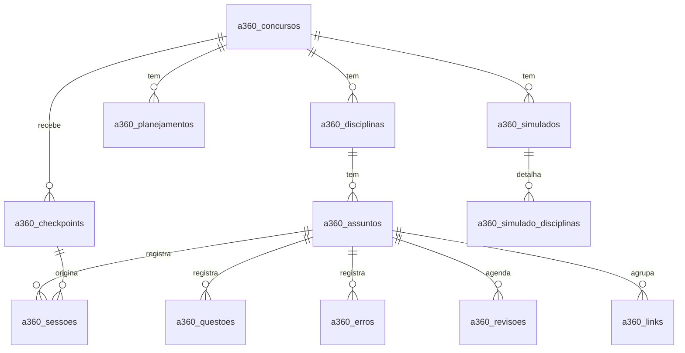

# Projeto: Aprovação 360° — Plataforma de Estudos para Concursos

**Versão:** 1.1 (duas IAs: Claude e ChatGPT) · **Data:** 09/11/2026 · **Autor:** usuário (CEC Contábil)

## 1. Visão geral

O Aprovação 360° é a **memória e o painel** de um sistema de estudos para concursos cuja **interface principal é a IA: Claude e ChatGPT**, usados com o mesmo método. O candidato estuda conversando com a IA, dentro de um Projeto configurado com o prompt "Aprovação 360° v2" (no ChatGPT, o núcleo de até 8.000 caracteres + o manual como arquivo). Ao final de cada sessão, a IA gera um bloco **CHECKPOINT**, no mesmo formato nas duas. O candidato cola esse bloco na plataforma, que atualiza sozinha o edital verticalizado, o desempenho, o caderno de erros e a fila de revisões.

O caminho inverso também é automático. O botão **"Estudar agora"** monta o **Prompt do Dia** (revisões vencidas, erros recorrentes e próxima matéria do ciclo), copia esse texto e abre a IA escolhida (Claude ou ChatGPT). A plataforma também exporta o **Registro Mestre (.md)** para ser subido nos Projetos das duas IAs. Com duas IAs, uma pode **auditar a outra** (comando `/conferir`), o que reduz o risco de erro em legislação e gabarito.

Usuário único, que acessa pelo computador e pelo celular. Foco inicial: **concursos de Fiscal/Auditor municipal (ISS)**, com suporte a vários concursos ao mesmo tempo.

**Ganho esperado (ESTIMATIVA):**
- Controle de estudos (planilha, anotações, montar revisões): de cerca de **3 h por semana para cerca de 20 min por semana (≈ 90%)**, porque nenhum dado é digitado à mão; tudo vem do CHECKPOINT.
- Início de cada sessão: de 10–15 min para reexplicar o contexto à IA para **1 clique** (≈ 95%).
- Nenhuma revisão esquecida, porque as datas são calculadas pela regra, não de cabeça.

## 2. Premissas e fora do escopo

**Premissas:**
- P01. O usuário é a única pessoa que usa o sistema.
- P02. O estudo propriamente dito (aulas, questões, correções) acontece **no Claude ou no ChatGPT**, não na plataforma. A plataforma **não chama nenhuma API de IA** na V1.
- P03. O Claude é configurado com `prompt-aprovacao-360-v2.md`. O ChatGPT, cujas instruções aceitam cerca de 8.000 caracteres, é configurado com `nucleo-chatgpt.md` nas instruções e `manual-aprovacao-360.md` (cópia do v2) como arquivo. Os dois definem os mesmos formatos dos blocos `=== CHECKPOINT ===` e `=== EDITAL ===` (seção 8, RN20 a RN23 e RN32).
- P04. A conta gratuita do Supabase do usuário tem um **slot de projeto livre** (o plano gratuito permite 2 projetos ativos). Se os dois já estiverem em uso (por exemplo, pelo Portal Solve), ver a alternativa em 5.1.
- P05. O sistema é usado praticamente todos os dias, o que evita a pausa automática do Supabase gratuito (7 dias sem uso).
- P06. Fuso horário: America/Sao_Paulo. "Hoje" é sempre a data local.
- P07. A Biblioteca guarda **apenas links**, não arquivos, por isso não usa armazenamento de arquivos.
- P08. O sistema é **independente** do ecossistema Solve Systems (decisão do usuário). Usa o padrão visual Solve por consistência, mas não o logo da empresa.

**Fora do escopo (versão 1):**
- IA embutida (chamada de API); está prevista como V2.
- Lembretes por e-mail ou notificação push (V2). Na V1 os avisos aparecem só no painel.
- Exportação de flashcards para o Anki (V2). Na V1, o próprio Claude gera o CSV pelo comando `/flashcards`.
- Banco de questões próprio. As questões são geradas pelo Claude ou resolvidas em sites externos (links na Biblioteca).
- Upload de arquivos (PDF do edital, apostilas). O edital fica no Projeto do Claude, e a plataforma guarda apenas o link.

## 3. Papéis neste módulo

Sistema de usuário único, independente do Portal Solve: não há papéis nem permissões. Existe um único perfil, o **titular**, que faz tudo. Cada linha de cada tabela pertence ao usuário logado (`usuario_id`), garantido por Row Level Security (RN30). Se um dia houver mais usuários (por exemplo, oferecer a plataforma a alunos), basta criar contas: os dados já são separados por usuário.

## 4. Pesquisa de referência e funcionalidades

### 4.1 Sistemas pesquisados

| Sistema | Site | Tipo | Destaque |
|---|---|---|---|
| Estudei | app.estudei.com.br | Comercial (gratuito + compras) | Planejamento automático, revisões com lembrete, edital verticalizado, caderno de erros, revisão espaçada (24 h / 7 d / 21 d), sequência de dias |
| Aprovado | App Store / Google Play | Comercial (módulos pagos à parte) | Revisão dia-semana-mês, ciclo de estudos, registro de exercícios com gráficos |
| Gran Questões / Gerenciador | questoes.grancursosonline.com.br | Comercial | Edital verticalizado (programa de estudos), questões comentadas por IA, Revisão Inteligente e cronograma com 1 clique (2026) |
| TecConcursos | tecconcursos.com.br | Comercial | Estatísticas de acerto e erro e evolução ao longo do tempo |
| Qconcursos | qconcursos.com | Comercial (gratuito + assinatura) | Banco de questões filtrado por banca, uso offline |

### 4.2 Matriz de funcionalidades

| Funcionalidade | Estudei | Aprovado | Gran | Tec | Qconc. | Classificação | Decisão do usuário |
|---|---|---|---|---|---|---|---|
| Edital verticalizado | ✔ | — | ✔ | — | — | Essencial | Aprovado (V1) |
| Fila de revisão espaçada | ✔ | ✔ | ✔ | — | — | Essencial | Aprovado (V1) |
| Caderno de erros com motivo | ✔ | — | — | ✔ (parcial) | ✔ (parcial) | Essencial | Aprovado (V1) |
| Estatísticas de desempenho | ✔ | ✔ | ✔ | ✔ | ✔ | Essencial | Aprovado (V1) |
| Ciclo de estudos | ✔ | ✔ | ✔ | — | — | Recomendada | Aprovado (V1) |
| Registro de simulados | ✔ | ✔ | ✔ | ✔ | ✔ | Recomendada | Aprovado (V1) |
| Sequência de dias estudados | ✔ | — | ✔ | — | — | Recomendada | Aprovado (V1) |
| Vários concursos/planos | ✔ | ✔ | ✔ | — | — | Recomendada | Aprovado (V1) |
| Cronômetro de estudo | ✔ | ✔ | ✔ | — | — | Recomendada | Aprovado (V1), pedido do usuário |
| Biblioteca de materiais | — | — | ✔ | — | ✔ | Recomendada | Aprovado (V1), só links |
| **IA como interface principal (CHECKPOINT + Prompt do Dia)** | — | — | — (acessória) | — | — | **Essencial (diferencial)** | Aprovado (V1) |
| Exportar Registro Mestre para a IA | — | — | — | — | — | Essencial (diferencial) | Aprovado (V1) |
| Duas IAs (Claude e ChatGPT) com verificação cruzada | — | — | — | — | — | Essencial (diferencial) | Aprovado (V1), pedido do usuário |
| Lembretes fora do sistema (push/e-mail) | ✔ | ✔ | ✔ | — | ✔ | Futura | V2 |
| IA embutida via API | — | — | ✔ | — | — | Futura | V2 (custo por uso) |
| Banco de questões próprio | — | — | ✔ | ✔ | ✔ | Fora | Não; usa Claude e sites externos |

### 4.3 Escopo aprovado

- **Versão 1:** importar CHECKPOINT, importar EDITAL, Prompt do Dia ("Estudar agora"), exportar Registro Mestre e backup, edital verticalizado com semáforo, fila de revisões 1-7-30-60, caderno de erros, painel de desempenho, ciclo com prioridade, simulados, sequência de dias, vários concursos, cronômetro e biblioteca de links.
- **Versão futura:** lembretes por e-mail/push (exige serviço externo), IA embutida via API (paga por uso), exportação direta para o Anki.

## 5. Arquitetura, tecnologia e custos

- **Tipo:** aplicação web aberta no navegador, responsiva (computador e celular a partir de 360 px). Instalável na tela inicial do celular (PWA simples: `manifest.json` + ícone).
- **Interface:** HTML + CSS + JavaScript puro, **sem etapa de compilação**. Arquivos: `index.html`, `estilo.css`, `app.js` (pode ser dividido em `js/*.js` por tela).
- **Banco de dados:** **Supabase (PostgreSQL), plano gratuito**. É necessário porque os dados precisam sincronizar entre computador e celular, e o Supabase já traz login com Google e segurança por linha.
- **Hospedagem:** **GitHub Pages** (gratuito, https). Endereço do tipo `https://<usuario>.github.io/aprovacao360/`.
- **Bibliotecas (CDN, gratuitas):** supabase-js v2, Chart.js (gráficos), Lucide (ícones), fonte Inter (Google Fonts). Nada além disso.
- **Autenticação:** **login com Google** pelo Supabase Auth, com um botão "Entrar com Google". A sessão fica salva no navegador, então não é preciso entrar toda vez.
- **Importação/exportação:**
  - Importa: texto colado dos blocos CHECKPOINT e EDITAL; arquivo `.json` de backup.
  - Exporta: `registro-mestre.md`, backup `.json` completo e caderno de erros em `.csv`.
- **Alternativa futura:** para IA embutida (V2), criar uma Supabase Edge Function que chama a API do Claude. O custo é por uso (ver 5.1).

### 5.1 Custos

Limites do Supabase gratuito conferidos em 11/2026: 500 MB de banco, 1 GB de arquivos, 5 GB de tráfego por mês, 50.000 usuários ativos, 2 projetos ativos, pausa após 7 dias sem uso (restaurável) e sem backup automático. **Conferir os limites atuais no site antes de construir.**

| Componente | Escolha | Custo | Limite gratuito relevante | Se passar do limite |
|---|---|---|---|---|
| Banco + login | Supabase Free | R$ 0 | 500 MB de banco; 2 projetos ativos; pausa após 7 dias parado | Reativar no painel do Supabase (os dados não se perdem). Pro custa US$ 25/mês e é desnecessário aqui |
| Login Google | Google Cloud (OAuth) | R$ 0 | Sem custo para login | — |
| Hospedagem | GitHub Pages | R$ 0 | 1 GB por site, tráfego amplo | — |
| Bibliotecas | CDN públicas | R$ 0 | — | — |
| IA | Claude e ChatGPT (assinaturas que o usuário já tem) | R$ 0 adicional | Limites de cada plano; no ChatGPT, instruções de cerca de 8.000 caracteres (resolvido com núcleo + manual em arquivo) | — |
| Backup | Exportação .json manual + lembrete semanal (RN27) | R$ 0 | — | — |

**Conta de capacidade:** cada linha de sessão, questão, erro ou revisão ocupa cerca de 0,5 KB. Com uso intenso (6 sessões, 6 registros de questões, 10 erros e 6 revisões por dia), são cerca de 28 linhas por dia × 0,5 KB ≈ 14 KB/dia ≈ **5 MB por ano**. Somando os checkpoints guardados em texto (cerca de 3 KB × 3 por dia ≈ 3,3 MB/ano), o total fica em **menos de 10 MB por ano**: os 500 MB durariam mais de **50 anos**. O armazenamento de arquivos não é usado.

**Armadilhas do plano gratuito e soluções:**

| Armadilha | Solução gratuita |
|---|---|
| Pausa após 7 dias sem uso (férias, por exemplo) | Uso diário. Se pausar, reativar no painel do Supabase; o banner da RN28 orienta |
| Sem backup automático | Botão "Baixar backup (.json)" e lembrete no painel se o último backup tiver mais de 7 dias (RN27) |
| Os 2 slots de projeto já ocupados (P04) | Opção A: usar o mesmo projeto Supabase do Portal Solve, com tabelas prefixadas `a360_` e RLS por `usuario_id`. Opção B: Firebase (plano Spark). Decidir na etapa 1 da construção |

**Custo total para construir e operar: R$ 0.**

### 5.2 Integração com o ecossistema

Sistema **independente** (decisão do usuário): não usa tabelas do Portal Solve nem é registrado como módulo. As tabelas nascem aqui com o prefixo `a360_`, para que possam conviver no mesmo projeto Supabase do Portal se a opção A de 5.1 for escolhida, sem conflito de nomes.

| Dado / tabela | Origem (sistema dono) | Uso neste sistema | Leitura ou escrita |
|---|---|---|---|
| `auth.users` | Supabase Auth | Identificar o usuário logado (`usuario_id`) | Leitura |
| Todas as tabelas `a360_*` | Este sistema | Dados de estudo | Leitura e escrita |
| Prompt e Registro Mestre | Projetos no Claude e no ChatGPT | Troca por texto (CHECKPOINT, EDITAL, Prompt do Dia, Registro Mestre) | Copiar e colar / download |

## 6. Banco de dados

**Convenções para todas as tabelas:** `id` (uuid, gerado), `usuario_id` (uuid, obrigatório, padrão `auth.uid()`), `criado_em` e `atualizado_em` (timestamptz, automáticos) e `excluido_em` (timestamptz, nulo = ativo; exclusão lógica, RN31). Esses campos não são repetidos nas tabelas abaixo. Datas em `date` (AAAA-MM-DD), exibidas como DD/MM/AAAA.

### 6.1 Diagrama de relacionamentos



### 6.2 Tabelas

#### Tabela `a360_concursos`
Cada concurso-alvo, sem misturar com os demais.

| Campo | Tipo | Obrigatório | Regras / validação | Exemplo |
|---|---|---|---|---|
| codigo | texto (até 40) | sim | Único por usuário; formato livre, sugestão `ORGAO-CARGO-ANO`; sem espaços | `ISS-SP-AFTM-2026` |
| orgao | texto | sim | — | Prefeitura de São Paulo |
| cargo | texto | sim | — | Auditor Fiscal Tributário Municipal |
| banca | texto | não | — | FGV |
| edital_numero | texto | não | — | 01/2026 |
| data_publicacao | data | não | — | 2026-08-15 |
| data_prova | data | não | Se informada, não pode ser anterior à data de publicação | 2027-02-21 |
| status | texto | sim | `previsto`, `publicado` ou `encerrado`; padrão `previsto` | publicado |
| retificacoes | texto longo | não | Texto livre (nº e data de cada retificação) | Ret. 01 de 02/09/2026 |
| link_edital | texto (URL) | não | Começa com http(s):// | https://… |
| prioritario | booleano | sim | Só um concurso prioritário por usuário (RN09) | true |

#### Tabela `a360_disciplinas`

| Campo | Tipo | Obrigatório | Regras / validação | Exemplo |
|---|---|---|---|---|
| concurso_id | uuid → a360_concursos | sim | — | — |
| nome | texto | sim | Único dentro do concurso, sem diferenciar maiúsculas e acentos (RN22) | Direito Tributário |
| peso | inteiro 1–5 | sim | Padrão 3 | 5 |
| incidencia | inteiro 1–5 | sim | Padrão 3 | 5 |
| horas_ciclo | decimal (1 casa) | não | Horas por semana atribuídas pelo ciclo (RN06); recalculado | 4,5 |
| ordem | inteiro | sim | Ordem de exibição | 1 |

#### Tabela `a360_assuntos`
Itens do edital verticalizado.

| Campo | Tipo | Obrigatório | Regras / validação | Exemplo |
|---|---|---|---|---|
| disciplina_id | uuid → a360_disciplinas | sim | — | — |
| item_edital | texto (até 20) | não | Número do item no edital | 3.2 |
| descricao | texto | sim | Única dentro da disciplina (RN22) | Lançamento tributário |
| status | texto | sim | `nao_iniciado`, `em_estudo`, `revisao` ou `dominado` (RN04); padrão `nao_iniciado` | em_estudo |
| ultima_atividade | data | não | Atualizado a cada sessão, questão ou revisão | 2026-11-09 |
| ultimo_ponto | texto | não | Vem da linha `ULTIMO_PONTO` do CHECKPOINT | Parei em revisão de ofício (art. 149 CTN) |
| dificuldades | texto longo | não | Acumula as linhas `DIFICULDADE`, com data | 09/11: confunde homologação x ofício |
| ordem | inteiro | sim | — | 12 |

#### Tabela `a360_planejamentos`
Versões do planejamento. Só uma é a vigente por concurso.

| Campo | Tipo | Obrigatório | Regras / validação | Exemplo |
|---|---|---|---|---|
| concurso_id | uuid | sim | — | — |
| versao | inteiro | sim | Sequencial por concurso | 2 |
| data_aprovacao | data | sim | — | 2026-11-09 |
| horas_semana | decimal | sim | > 0 e ≤ 100 | 20 |
| meta_questoes_semana | inteiro | sim | ≥ 0 | 250 |
| vigente | booleano | sim | Só uma vigente por concurso (RN10) | true |
| observacoes | texto longo | não | Justificativa da mudança | Aumento de horas nas férias |

#### Tabela `a360_checkpoints`
Texto original de cada CHECKPOINT importado, para auditoria e para refazer a importação se necessário.

| Campo | Tipo | Obrigatório | Regras / validação | Exemplo |
|---|---|---|---|---|
| concurso_id | uuid | sim | Pelo campo `concurso:` do bloco | — |
| data_referencia | data | sim | Pelo campo `data:` do bloco | 2026-11-09 |
| conversa | texto | não | Comando, Editais, Aula, Questoes ou Desempenho | Aula |
| ia | texto | não | `claude`, `chatgpt` ou `outra`; pelo campo `ia:` do bloco (RN32) | chatgpt |
| texto_original | texto longo | sim | Bloco completo colado | === CHECKPOINT === … |
| hash | texto | sim | SHA-256 do texto normalizado; único por usuário (RN21) | a3f… |
| resumo | jsonb | sim | Contagem por tipo de linha importada | {"sessoes":2,"erros":3} |
| proxima | texto | não | Linha `PROXIMA` | /aula Imunidades |
| propostas | texto longo | não | Linhas `PROPOSTA` (exibidas no painel até serem marcadas como vistas) | — |
| correcoes | texto longo | não | Linhas `CORRECAO` | — |
| propostas_vistas | booleano | sim | Padrão false | false |

#### Tabela `a360_sessoes`

| Campo | Tipo | Obrigatório | Regras / validação | Exemplo |
|---|---|---|---|---|
| concurso_id | uuid | sim | — | — |
| disciplina_id | uuid | sim | — | — |
| assunto_id | uuid | não | Nulo quando a sessão é da disciplina inteira | — |
| data | data | sim | Não pode ser futura se status = REALIZADO | 2026-11-09 |
| tipo | texto | sim | `aula`, `rapida`, `questoes`, `revisao`, `simulado`, `lei_seca`, `leitura` | aula |
| status | texto | sim | `PLANEJADO`, `REALIZADO`, `PENDENTE`, `CANCELADO`, `REPROGRAMADO` | REALIZADO |
| minutos | inteiro | sim | 0–720; padrão 0 | 50 |
| origem | texto | sim | `checkpoint`, `cronometro` ou `manual` | checkpoint |
| ia | texto | não | `claude`, `chatgpt` ou `outra`; herdado do checkpoint | claude |
| checkpoint_id | uuid | não | Preenchido quando a origem é checkpoint | — |

#### Tabela `a360_questoes`
Lotes de questões resolvidas (não as questões em si).

| Campo | Tipo | Obrigatório | Regras / validação | Exemplo |
|---|---|---|---|---|
| assunto_id | uuid | sim | — | — |
| disciplina_id | uuid | sim | Redundante, para facilitar consultas | — |
| data | data | sim | — | 2026-11-09 |
| feitas | inteiro | sim | ≥ 1 | 10 |
| acertos | inteiro | sim | 0 ≤ acertos ≤ feitas | 7 |
| origem | texto | sim | `checkpoint` ou `manual` | checkpoint |
| checkpoint_id | uuid | não | — | — |

#### Tabela `a360_erros`
Caderno de erros.

| Campo | Tipo | Obrigatório | Regras / validação | Exemplo |
|---|---|---|---|---|
| assunto_id | uuid | sim | — | — |
| disciplina_id | uuid | sim | — | — |
| data | data | sim | — | 2026-11-09 |
| motivo | texto | sim | `conceito`, `letra_da_lei`, `pegadinha`, `interpretacao`, `calculo`, `atencao`, `chute` | letra_da_lei |
| descricao | texto | sim | Até 500 caracteres | Prazo decadencial é de 5 anos, não 10 (art. 173 CTN) |
| revisado | booleano | sim | Padrão false | false |
| data_revisado | data | não | Preenchido ao marcar como revisado | — |
| checkpoint_id | uuid | não | — | — |

#### Tabela `a360_revisoes`
Fila de revisões espaçadas. Cada assunto tem **no máximo uma revisão pendente** por vez (RN02).

| Campo | Tipo | Obrigatório | Regras / validação | Exemplo |
|---|---|---|---|---|
| assunto_id | uuid | sim | — | — |
| data_estudo_original | data | sim | Data da primeira sessão de estudo do assunto | 2026-11-09 |
| etapa | inteiro | sim | 1, 7, 30 ou 60 (dias) | 7 |
| data_prevista | data | sim | Calculada (RN01/RN02) | 2026-11-17 |
| status | texto | sim | `pendente` ou `concluida` | pendente |
| resultado | inteiro 0–100 | não | % de acerto na revisão | 80 |
| data_realizada | data | não | — | — |

#### Tabela `a360_simulados`

| Campo | Tipo | Obrigatório | Regras / validação | Exemplo |
|---|---|---|---|---|
| concurso_id | uuid | sim | — | — |
| data | data | sim | — | 2026-11-08 |
| nome | texto | sim | — | Simulado 3 – Claude estilo FGV |
| origem | texto | sim | `claude`, `cursinho`, `prova_anterior` ou `outro` | claude |
| total_questoes | inteiro | sim | ≥ 1 | 80 |
| acertos | inteiro | sim | ≤ total | 58 |
| tempo_minutos | inteiro | não | — | 240 |
| observacoes | texto longo | não | — | Faltou tempo em Contabilidade |

#### Tabela `a360_simulado_disciplinas`

| Campo | Tipo | Obrigatório | Regras / validação | Exemplo |
|---|---|---|---|---|
| simulado_id | uuid | sim | — | — |
| disciplina_id | uuid | sim | — | — |
| questoes | inteiro | sim | ≥ 1; a soma das disciplinas não pode passar do total do simulado | 20 |
| acertos | inteiro | sim | ≤ questões | 15 |

#### Tabela `a360_links`
Biblioteca de links.

| Campo | Tipo | Obrigatório | Regras / validação | Exemplo |
|---|---|---|---|---|
| concurso_id | uuid | sim | — | — |
| disciplina_id | uuid | não | — | — |
| assunto_id | uuid | não | Se preenchido, a disciplina é preenchida automaticamente | — |
| titulo | texto | sim | — | CTN – Planalto |
| url | texto | sim | Começa com http(s):// | https://www.planalto.gov.br/ccivil_03/leis/l5172compilado.htm |
| tipo | texto | sim | `lei`, `pdf`, `video`, `questoes`, `jurisprudencia`, `outro` | lei |
| favorito | booleano | sim | Padrão false | true |

#### Tabela `a360_configuracoes`
Uma linha por usuário.

| Campo | Tipo | Obrigatório | Regras / validação | Exemplo |
|---|---|---|---|---|
| concurso_ativo_id | uuid | não | Concurso exibido nas telas | — |
| url_projeto_claude | texto | não | URL do Projeto no Claude; vazio = https://claude.ai | https://claude.ai/project/… |
| url_projeto_chatgpt | texto | não | URL do Projeto (ou GPT personalizado) no ChatGPT; vazio = https://chatgpt.com | https://chatgpt.com/g/… |
| ia_padrao | texto | sim | `claude` ou `chatgpt`; padrão `claude`; define o botão em destaque | claude |
| minimo_minutos_streak | inteiro | sim | Padrão 15 (RN08) | 15 |
| ultimo_backup | timestamptz | não | Atualizado ao baixar o backup | — |
| ultimo_registro_exportado | timestamptz | não | — | — |
| perfil_md | texto longo | não | Seção "Perfil do candidato" do Registro Mestre, colada pelo usuário; reaproveitada na exportação (RN24) | \| Horas por dia \| 3 \| … |

## 7. Telas

### 7.1 Mapa de navegação

Cabeçalho fixo (Marinho): nome "Aprovação 360°", **seletor de concurso ativo**, ícone da sequência 🔥 com o número de dias, botão do **cronômetro** e foto do Google com o menu (Sair).

Menu lateral (no celular vira barra inferior com 5 itens e um "Mais"):
1. **Hoje** (painel), a tela inicial
2. **Importar** (CHECKPOINT / EDITAL)
3. **Edital** (verticalizado)
4. **Revisões**
5. **Erros**
6. **Ciclo**
7. **Simulados**
8. **Biblioteca**
9. **Concursos**
10. **Configurações e backup**

Barra inferior do celular: Hoje · Importar · Edital · Revisões · Mais.

### 7.2 Tela: Entrar
- **Objetivo:** fazer login.
- **Layout:** fundo Marinho, cartão branco centralizado com o nome "Aprovação 360°", a frase "Sua IA estuda com você. Aqui fica a memória." e o botão "Entrar com Google".
- **Ações:**

  | Botão / ação | O que faz | Mensagem de sucesso | Mensagem de erro |
  |---|---|---|---|
  | Entrar com Google | `supabase.auth.signInWithOAuth({provider:'google'})` e volta para Hoje | — | "Não foi possível entrar. Verifique sua conexão e tente de novo." |
- **Estados:** sessão existente → vai direto para Hoje. Banco pausado (erro de conexão persistente) → banner RN28.

### 7.3 Tela: Hoje (painel)
- **Objetivo:** em 5 segundos, saber o que fazer agora e começar.
- **Layout (de cima para baixo):**
  1. **Cartão principal "Estudar agora"** (destaque Primária): mostra em 3 linhas as revisões vencidas (quantidade), a próxima matéria do ciclo (RN07) e a quantidade de erros não revisados. Botões: **"Estudar no Claude"** e **"Estudar no ChatGPT"** (o da `ia_padrao` em destaque, o outro como secundário) e "Ver prompt".
  2. **Indicadores (4 cartões):** dias até a prova · % do edital coberto (RN13) · % de acerto geral nos últimos 30 dias · horas na semana / meta.
  3. **Revisões de hoje:** lista dos assuntos com revisão vencida ou para hoje (disciplina > assunto, etapa, atraso em dias).
  4. **Alertas:** propostas pendentes do Claude (linhas PROPOSTA), correções (CORRECAO), backup atrasado (RN27).
  5. **Gráfico:** % de acerto por disciplina (barras horizontais, Chart.js), ordenado do pior para o melhor.
  6. **Última atividade:** a `PROXIMA` do último checkpoint.
- **Ações:**

  | Botão / ação | O que faz | Mensagem de sucesso | Mensagem de erro |
  |---|---|---|---|
  | Estudar no Claude / Estudar no ChatGPT | Monta o Prompt do Dia (RN12), copia para a área de transferência e abre `url_projeto_claude` ou `url_projeto_chatgpt` em nova aba | "Prompt copiado! Cole no Claude (Ctrl+V)." / "… no ChatGPT" | "Não consegui copiar automaticamente. Use o botão Copiar." (abre o prompt numa janela com botão Copiar) |
  | Ver prompt | Abre uma janela com o prompt editável e o botão Copiar | — | — |
  | Clicar numa revisão | Leva para Revisões com o item em destaque | — | — |
  | Marcar proposta como vista | `propostas_vistas = true` | "Ok." | — |
- **Estados:**
  - Sem concurso: "Comece cadastrando seu concurso ou importe um EDITAL gerado pelo Claude." + botões "Importar EDITAL" e "Novo concurso".
  - Sem dados de estudo: indicadores com "—" e a dica "Estude no Claude e cole o CHECKPOINT em Importar."
  - Carregando: esqueleto cinza nos cartões.
- **Regras aplicadas:** RN07, RN08, RN12, RN13, RN14, RN27.

### 7.4 Tela: Importar
- **Objetivo:** colar os blocos gerados pelo Claude e atualizar tudo.
- **Layout:** duas abas, **CHECKPOINT** (padrão) e **EDITAL**. Uma área de texto grande ("Cole aqui o bloco gerado pelo Claude"), o botão "Analisar" e, depois da análise, uma **pré-visualização** em tabela com o que será gravado.
- **Fluxo CHECKPOINT:**
  1. O usuário cola o texto e clica em "Analisar". A plataforma detecta o bloco entre `=== CHECKPOINT ===` e `=== FIM ===` (ignora o que estiver fora) e interpreta as linhas (RN20).
  2. Pré-visualização agrupada: Sessões · Questões · Erros · Revisões · Dificuldades · Último ponto · Próxima · Propostas · Correções. Cada linha mostra ✔ (ok), ⚠ (assunto não encontrado) ou ✖ (linha inválida, com o motivo).
  3. Para cada ⚠, um seletor: "Associar a assunto existente" (lista da disciplina, com o mais parecido pré-selecionado, RN22) ou "Criar novo assunto".
  4. Botão **"Confirmar importação"**: grava tudo numa única transação (função RPC `a360_importar_checkpoint`) e recalcula revisões (RN01/RN02), status (RN04) e ciclo (RN06).
- **Fluxo EDITAL:** igual, com as linhas `CONCURSO`, `DISCIPLINA` e `ASSUNTO` (RN23). Se o código do concurso já existir, pergunta: "Atualizar o concurso X? Disciplinas e assuntos novos serão acrescentados; nada será apagado."
- **Ações:**

  | Botão / ação | O que faz | Mensagem de sucesso | Mensagem de erro |
  |---|---|---|---|
  | Analisar | Interpreta o texto | — | "Não encontrei um bloco '=== CHECKPOINT ===' … '=== FIM ==='. Copie o bloco inteiro gerado pelo Claude." |
  | Confirmar importação | Grava | "Checkpoint de 09/11/2026 importado: 2 sessões, 15 questões, 3 erros, 1 revisão." | "Este checkpoint já foi importado em DD/MM/AAAA." (RN21) / "Concurso 'X' não cadastrado. Importe o EDITAL primeiro ou escolha o concurso:" (seletor) |
  | Cancelar | Limpa a análise | — | — |
- **Estados:** linhas inválidas não impedem a importação das válidas, mas o botão mostra "Importar 12 de 14 linhas". Se houver ⚠ sem decisão, o botão fica desativado com a dica "Decida os assuntos marcados com ⚠".
- **Regras aplicadas:** RN01–RN04, RN20–RN23.

### 7.5 Tela: Edital (verticalizado)
- **Objetivo:** ver o edital inteiro com o progresso de cada assunto.
- **Layout:** barra de progresso geral (RN13). Uma lista de disciplinas recolhíveis, cada uma com peso, incidência, prioridade, % de acerto e uma mini barra de progresso. Dentro de cada disciplina, a tabela de assuntos.
- **Colunas dos assuntos:** item · assunto · status (semáforo com cor + texto: "Nunca visto" vermelho, "Em estudo" amarelo/Alerta, "Revisão" Aço, "Dominado" verde) · questões · % acerto · última atividade · próxima revisão.
- **Filtros:** status, disciplina, busca por texto.
- **Ações:**

  | Botão / ação | O que faz | Mensagem de sucesso | Mensagem de erro |
  |---|---|---|---|
  | Clicar no assunto | Painel lateral com o histórico (sessões, questões, erros, revisões, dificuldades, último ponto, links) e o botão **"Estudar este assunto"** (gera o prompt focado, RN12) | — | — |
  | + Assunto / + Disciplina | Formulário lateral | "Assunto incluído." | "Já existe um assunto com esse nome nesta disciplina." |
  | Editar peso/incidência | Inline (1–5) | "Prioridade recalculada." | — |
  | Alterar status manualmente | Só permite voltar para `em_estudo`; `dominado` é sempre automático (RN04) | "Status atualizado." | "Dominado é calculado: ≥ 80% em ≥ 20 questões, em 2 dias diferentes." |
  | Excluir | Exclusão lógica com confirmação | "Assunto excluído." | — |
- **Estados:** vazio → "Nenhum edital ainda. No Claude, use /edital e cole aqui o bloco EDITAL." + botão "Importar EDITAL".
- **Regras aplicadas:** RN04, RN05, RN13, RN31.

### 7.6 Tela: Revisões
- **Objetivo:** cumprir a fila de revisões.
- **Layout:** três grupos, **Atrasadas** (Erro), **Hoje** (Alerta) e **Próximos 7 dias** (Aço), e um calendário mensal simples com a quantidade de revisões por dia.
- **Colunas:** disciplina > assunto · etapa (1/7/30/60) · data prevista · atraso · último resultado.
- **Ações:**

  | Botão / ação | O que faz | Mensagem de sucesso | Mensagem de erro |
  |---|---|---|---|
  | **Revisar no Claude** (por item ou "Revisar todas de hoje") | Gera o prompt de revisão (RN12, variante revisão), copia e abre o Claude | "Prompt de revisão copiado!" | — |
  | Registrar resultado | Campo 0–100 (%) → conclui e agenda a próxima (RN02) | "Próxima revisão: DD/MM/AAAA (etapa X)." | "Informe um número de 0 a 100." |
  | Reprogramar | Escolhe nova data (≥ hoje) | "Revisão reprogramada para DD/MM." | "A data não pode ser no passado." |
- **Estados:** vazio → "Nenhuma revisão pendente. 🎉"
- **Regras aplicadas:** RN01, RN02, RN03.

### 7.7 Tela: Caderno de erros
- **Objetivo:** atacar os erros recorrentes.
- **Layout:** no topo, um gráfico de **erros por motivo** (rosca) e o **top 5 assuntos com mais erros** em 30 dias. Abaixo, uma tabela filtrável.
- **Colunas:** data · disciplina > assunto · motivo (etiqueta colorida) · descrição · revisado (✔/—).
- **Filtros:** disciplina, motivo, revisado/não revisado, período.
- **Ações:**

  | Botão / ação | O que faz | Mensagem de sucesso | Mensagem de erro |
  |---|---|---|---|
  | **Treinar estes erros no Claude** | Usa os erros filtrados (máx. 15, os não revisados primeiro) para gerar o prompt `/erros` (RN12), copiar e abrir o Claude | "Prompt copiado com N erros." | "Nenhum erro no filtro atual." |
  | Marcar revisado | `revisado = true`, `data_revisado = hoje` | — | — |
  | + Erro manual | Formulário lateral | "Erro registrado." | Campos obrigatórios em vermelho |
  | Exportar CSV | Baixa `caderno-de-erros.csv` (separador `;`, UTF-8 com BOM) | — | — |
- **Regras aplicadas:** RN12, RN15.

### 7.8 Tela: Ciclo
- **Objetivo:** ver e aprovar a distribuição semanal das horas.
- **Layout:** cartão do **planejamento vigente** (versão, data de aprovação, horas/semana, meta de questões). Uma tabela do ciclo com disciplina, peso, incidência, % acerto, **prioridade** (com tooltip mostrando a conta), horas no ciclo, horas realizadas na semana e uma barra de cumprimento. Destaque na **próxima da vez** (RN07).
- **Ações:**

  | Botão / ação | O que faz | Mensagem de sucesso | Mensagem de erro |
  |---|---|---|---|
  | Nova versão do planejamento | Formulário com horas/semana, meta e justificativa → mostra a **prévia** da nova distribuição ao lado da atual → "Aprovar" cria a nova versão vigente (RN10) | "Planejamento v3 aprovado." | "Horas por semana deve ser maior que zero." |
  | Recalcular com dados atuais | Mostra a prévia da redistribuição pela RN06 sem gravar → "Aprovar" grava como nova versão | idem | — |
  | Histórico | Lista as versões anteriores | — | — |
- **Estados:** sem planejamento → "Defina suas horas por semana para montar o ciclo." + formulário.
- **Regras aplicadas:** RN05, RN06, RN07, RN10.

### 7.9 Tela: Simulados
- **Objetivo:** registrar simulados e ver a evolução.
- **Layout:** gráfico de linha com o % de acerto ao longo do tempo (com linha de meta tracejada, se definida). Uma tabela de simulados e o formulário lateral.
- **Campos:** data, nome, origem, total de questões, acertos, tempo e observações, mais a tabela por disciplina (opcional; disciplinas do concurso pré-listadas).
- **Ações:**

  | Botão / ação | O que faz | Mensagem de sucesso | Mensagem de erro |
  |---|---|---|---|
  | + Simulado | Grava | "Simulado registrado: 72,5% de acerto." | "Acertos não podem ser maiores que o total." / "A soma das disciplinas (85) passa do total (80)." |
  | Ver detalhe | % por disciplina comparado com a média geral da disciplina | — | — |
- **Regras aplicadas:** RN16.

### 7.10 Tela: Biblioteca
- **Objetivo:** ter à mão os links de lei seca, PDFs, vídeos e questões por assunto.
- **Layout:** busca, filtros (disciplina, tipo, favoritos) e uma lista em cartões (ícone do tipo, título, disciplina > assunto, ★).
- **Ações:** + Link (formulário lateral), abrir (nova aba), favoritar, editar, excluir (lógico, com confirmação).
- **Mensagens:** "Link salvo." / "Informe um endereço que comece com http:// ou https://".
- **Estados:** vazio → "Guarde aqui os links de lei seca (Planalto, Código Tributário Municipal), PDFs e videoaulas."
- **Integração:** os links do assunto aparecem no painel lateral do assunto (7.5) e entram no Prompt do Dia focado (RN12).

### 7.11 Tela: Concursos
- **Objetivo:** cadastrar e alternar concursos.
- **Layout:** cartões, um por concurso (código, órgão, cargo, banca, data da prova, dias restantes, status e % do edital), com a estrela de prioritário.
- **Ações:**

  | Botão / ação | O que faz | Mensagem de sucesso | Mensagem de erro |
  |---|---|---|---|
  | + Concurso | Formulário lateral (campos de 6.2) | "Concurso cadastrado." | "Já existe um concurso com o código X." |
  | Tornar ativo | Muda o concurso exibido em todas as telas | — | — |
  | Marcar como prioritário | Desmarca o anterior (RN09) | "X agora é o prioritário." | — |
  | **Duplicar estrutura** | Copia disciplinas e assuntos de um concurso para outro **só após confirmação explícita** e com os status zerados (RN11) | "Estrutura copiada. Revise pesos e itens conforme o novo edital." | — |
  | Encerrar / Excluir | Status `encerrado` / exclusão lógica | — | — |
- **Regras aplicadas:** RN09, RN11.

### 7.12 Tela: Configurações e backup
- **Campos:** URL do Projeto no Claude e URL do Projeto/GPT no ChatGPT (ajuda: "Abra seu Projeto e copie o endereço da barra"), IA padrão, minutos mínimos para a sequência, perfil do candidato (`perfil_md`, área de texto: "Cole aqui a seção Perfil do seu Registro Mestre").
- **Ações:**

  | Botão / ação | O que faz | Mensagem de sucesso | Mensagem de erro |
  |---|---|---|---|
  | **Exportar Registro Mestre (.md)** | Gera `registro-mestre.md` (RN24) do concurso ativo e baixa | "Registro Mestre baixado. Suba-o nos arquivos do Projeto no Claude (substitua o anterior)." | — |
  | Baixar backup (.json) | Todas as tabelas do usuário, sem os excluídos há mais de 1 ano | "Backup baixado." | — |
  | Restaurar backup | Lê o .json, mostra o resumo e, com confirmação, grava por cima (upsert por id) | "Backup restaurado: N registros." | "Arquivo inválido: não é um backup do Aprovação 360°." |
  | Copiar prompt do Claude | Copia o prompt v2 completo, para as instruções do Projeto no Claude | "Copiado." | — |
  | Copiar núcleo do ChatGPT | Copia o `nucleo-chatgpt.md` (menos de 8.000 caracteres), para as instruções do ChatGPT | "Copiado." | — |
  | Baixar manual (.md) | Baixa `manual-aprovacao-360.md`, para subir como arquivo no ChatGPT | — | — |
- **Regras aplicadas:** RN24–RN27.

### 7.13 Componente: Cronômetro
- **Objetivo:** medir o tempo líquido de estudo.
- **Layout:** botão no cabeçalho. Quando ligado, vira uma pílula fixa (Primária) com o tempo correndo, visível em qualquer tela, e os botões ⏸ e ⏹.
- **Fluxo:** ▶ abre uma janela pequena para escolher disciplina e assunto (opcional) e o tipo; começa a contar. ⏸ pausa (o tempo pausado não conta). ⏹ abre a confirmação "Salvar 52 min de Direito Tributário > Lançamento?" com os botões Salvar e Descartar.
- **Mensagens:** "Sessão de 52 min salva." / sessões abaixo de 1 min: "Sessão muito curta, não foi salva."
- **Regras aplicadas:** RN17, RN18.

## 8. Regras de negócio

| Código | Regra | Onde se aplica |
|---|---|---|
| RN01 | **Primeira revisão.** Quando um assunto recebe sua **primeira** sessão REALIZADA de tipo `aula`, `rapida`, `leitura` ou `lei_seca` (e não tem revisão pendente), cria-se uma revisão com `etapa = 1`, `data_estudo_original = data da sessão` e `data_prevista = data + 1 dia`. Exemplo: aula em 09/11 → revisão em 10/11. | Importar, Cronômetro, sessão manual |
| RN02 | **Próxima revisão.** Ao registrar o resultado R (%) de uma revisão na etapa E (sequência 1 → 7 → 30 → 60): se R ≥ 85, avança uma etapa (após 60, permanece em 60); se 70 ≤ R < 85, repete a etapa; se R < 70, volta uma etapa (mínimo 1). A nova `data_prevista = data da realização + nova etapa em dias`. A revisão atual vira `concluida`. Só existe **uma** revisão pendente por assunto. Exemplo: etapa 7, revisão feita em 17/11 com 65% → etapa 1, próxima em 18/11. Exemplo 2: etapa 7 com 90% → etapa 30, próxima em 17/12. | Revisões, Importar (linha REVISAO) |
| RN03 | **Revisão via CHECKPOINT.** A linha `REVISAO \| disc \| assunto \| R` aplica a RN02 à revisão pendente do assunto, com data = `data:` do checkpoint. Se não houver revisão pendente, cria uma concluída com etapa 1 e aplica a RN02 a partir dela. | Importar |
| RN04 | **Status do assunto (automático).** `nao_iniciado`: sem nenhuma sessão ou questão. `em_estudo`: tem atividade, mas não cumpre a regra de dominado e não tem revisão concluída com R ≥ 70. `revisao`: tem pelo menos uma revisão concluída com R ≥ 70. `dominado`: **≥ 20 questões no total, acerto ≥ 80% e questões em pelo menos 2 datas diferentes**. Se depois de dominado o acerto cair abaixo de 80%, volta para `revisao`. O usuário só pode rebaixar manualmente para `em_estudo`. | Edital, Importar |
| RN05 | **Prioridade da disciplina** = peso × incidência × (1 − acerto). "acerto" é o % de acerto da disciplina (soma de acertos ÷ soma de feitas) quando ela tem **≥ 10 questões**; abaixo disso, usa-se 0,5. Exemplo: Direito Tributário com peso 5, incidência 5 e 60% de acerto → 5 × 5 × 0,4 = **10,0**. Português com peso 3, incidência 4 e sem dados → 3 × 4 × 0,5 = **6,0**. | Ciclo, Edital |
| RN06 | **Distribuição do ciclo.** horas_ciclo da disciplina = horas_semana × (prioridade ÷ soma das prioridades), arredondado a 0,5 h, com **mínimo de 0,5 h** para toda disciplina com assunto não dominado. A diferença de arredondamento é ajustada na disciplina de maior prioridade. Exemplo: 20 h/semana, prioridades 10 / 6 / 4 (soma 20) → 10 h / 6 h / 4 h. Só grava ao **aprovar** uma nova versão (RN10). | Ciclo |
| RN07 | **Próxima da vez.** Para cada disciplina: déficit = horas_ciclo − horas REALIZADAS na semana corrente (segunda a domingo). A próxima é a de **maior déficit**; em empate, a de maior prioridade. Dentro dela, o assunto sugerido é o primeiro, pela ordem do edital, com status `nao_iniciado` ou `em_estudo` (prefere `em_estudo` com `ultimo_ponto` preenchido). | Hoje, Prompt do Dia |
| RN08 | **Sequência de dias (🔥).** Um dia conta se tiver sessões REALIZADAS somando ≥ `minimo_minutos_streak` (padrão 15) **ou** pelo menos um lote de questões. A sequência é o número de dias consecutivos até ontem que contam, mais 1 se hoje já contar. Hoje sem atividade não zera a sequência até o fim do dia. | Cabeçalho, Hoje |
| RN09 | Só um concurso pode ter `prioritario = true` por usuário. Ao marcar outro, o anterior é desmarcado. | Concursos |
| RN10 | **Planejamento.** Só uma versão vigente por concurso. Qualquer mudança em horas, metas ou distribuição gera nova versão, **só após o botão Aprovar** (que exige mostrar a prévia antes). A versão anterior continua no histórico. Nada no ciclo muda sozinho: a RN06 só é aplicada na aprovação. A tela pode mostrar a sugestão "Seus dados mudaram, recalcular?". | Ciclo |
| RN11 | **Concursos não se misturam.** Todas as telas e cálculos filtram pelo concurso ativo. Disciplinas e assuntos só passam de um concurso para outro pelo botão "Duplicar estrutura", com confirmação, e sem copiar desempenho, sessões, erros ou revisões. | Todas |
| RN12 | **Prompt do Dia.** Texto montado pela plataforma (modelo abaixo da tabela). Variantes: **geral** (botão Estudar agora), **assunto** (Estudar este assunto), **revisão** (Revisar no Claude) e **erros** (Treinar estes erros). Limites: até 10 revisões (as mais atrasadas primeiro), até 15 erros e até 5 links. | Hoje, Edital, Revisões, Erros |
| RN13 | **% do edital coberto** = assuntos com status ≠ `nao_iniciado` ÷ total de assuntos ativos. **% dominado** = assuntos `dominado` ÷ total. Exibir os dois. | Hoje, Edital |
| RN14 | **Dias até a prova** = data_prova − hoje. Se não houver data: "Data não definida". Se for negativo: "Prova realizada". | Hoje, Concursos |
| RN15 | **Erro recorrente** = assunto com ≥ 3 erros não revisados **ou** ≥ 2 erros com o mesmo motivo nos últimos 30 dias. | Hoje, Erros, Prompt do Dia |
| RN16 | % do simulado = acertos ÷ total × 100, com 1 casa decimal. A soma das disciplinas não pode passar do total. | Simulados |
| RN17 | **Cronômetro.** O estado (início, pausas, disciplina) é guardado no `localStorage` do navegador, para que fechar ou recarregar a aba não perca a contagem. Ao parar, grava uma sessão REALIZADA com `origem = cronometro` e os minutos líquidos (arredondados para baixo). Sessões com menos de 1 min não são gravadas. Cronômetro ligado há mais de 6 h: pergunta "Você ainda está estudando?" antes de salvar. | Cronômetro |
| RN18 | **Não duplicar tempo.** Se no mesmo dia já houver uma sessão do cronômetro para a mesma disciplina e assunto, e chegar pelo CHECKPOINT uma SESSAO com minutos > 0 para eles, a pré-visualização pergunta: "Já há 52 min do cronômetro para esse assunto hoje. Somar, substituir ou ignorar os minutos do checkpoint?" (padrão: **ignorar os minutos** e gravar a sessão com 0 min, mantendo o tipo). | Importar |
| RN19 | **Só o confirmado conta.** Nenhuma atividade é registrada como REALIZADA sem vir de um CHECKPOINT que o usuário importou, do cronômetro ou de lançamento manual. A plataforma nunca cria dados de desempenho por estimativa. | Todas |
| RN20 | **Leitura do CHECKPOINT.** O texto entre `=== CHECKPOINT ===` e `=== FIM ===` é lido linha a linha. Cabeçalho: `data:`, `concurso:`, `conversa:` e `ia:` (chave: valor; ver RN32). Linhas de dados: campos separados por `\|`, com espaços nas pontas removidos. A primeira palavra é o tipo, sem diferenciar maiúsculas: `SESSAO` (5 campos: disc, assunto, tipo, status, minutos), `QUESTOES` (4: disc, assunto, feitas, acertos), `ERRO` (4: disc, assunto, motivo, descrição), `REVISAO` (3: disc, assunto, %), `DIFICULDADE` (3), `ULTIMO_PONTO` (3), `PROXIMA` (1), `PROPOSTA` (1), `CORRECAO` (1). Também são aceitos `-` ou `•` no início da linha e asteriscos de negrito (removidos). Linha com tipo desconhecido ou quantidade de campos errada = inválida (✖, com o motivo). Valores de tipo, status e motivo aceitam variações sem acento e com espaço (ex.: "letra da lei" → `letra_da_lei`; "atenção" → `atencao`). Sem `data:`, usa hoje, com aviso. | Importar |
| RN21 | **Checkpoint repetido.** O hash é o SHA-256 do bloco com espaços e quebras de linha normalizados. Se já existir para o usuário, a importação é bloqueada com a data da importação anterior. | Importar |
| RN22 | **Correspondência de nomes.** Disciplina e assunto são comparados por texto normalizado (minúsculas, sem acentos, sem pontuação, espaços únicos). Se não houver igualdade exata, sugere o mais parecido (maior similaridade por bigramas de Dice ≥ 0,6) e marca ⚠ para o usuário decidir. Assunto "Geral" ou vazio = sessão da disciplina inteira (`assunto_id` nulo; não vale para QUESTOES e ERRO, que exigem assunto, e pedem para escolher). | Importar |
| RN23 | **Leitura do EDITAL.** Bloco `=== EDITAL ===` … `=== FIM ===`. `CONCURSO \| código \| órgão \| cargo \| banca \| edital \| data_prova` (exatamente 1 linha), `DISCIPLINA \| nome \| peso \| incidência` (peso e incidência de 1 a 5; fora disso, ajusta para 3 com aviso) e `ASSUNTO \| disciplina \| item \| descrição` (a disciplina tem que ter sido declarada no bloco ou já existir). Concurso existente: só acrescenta e atualiza peso e incidência; **nunca apaga** nada. A ordem das linhas define a `ordem`. | Importar |
| RN24 | **Registro Mestre exportado** segue a estrutura do arquivo `registro-mestre.md` (seções 1 a 10): perfil (texto de `perfil_md`; ver nota abaixo da tabela), concursos, planejamento vigente e ciclo, edital verticalizado com progresso, fila de revisões pendentes, caderno de erros (não revisados + 30 dias), histórico das últimas 30 sessões, próximas atividades (última PROXIMA), propostas pendentes e histórico de versões do planejamento. Cabeçalho com a data e a hora da exportação. | Configurações |
| RN25 | **Backup .json:** `{"app":"aprovacao360","versao_schema":1,"exportado_em":…, "tabelas":{…}}`. A restauração valida `app` e `versao_schema` antes de gravar. | Configurações |
| RN26 | Datas gravadas em ISO (AAAA-MM-DD) e exibidas em DD/MM/AAAA. Hoje = data local de America/Sao_Paulo. | Todas |
| RN27 | **Lembrete de backup:** se `ultimo_backup` for nulo ou tiver mais de 7 dias, o painel mostra o alerta "Faça seu backup semanal (1 clique)" com o botão. | Hoje |
| RN28 | **Banco pausado / sem conexão:** após 2 falhas seguidas de conexão, mostra o banner "Não consegui falar com o banco. Se você ficou mais de 7 dias sem usar, reative o projeto em supabase.com → seu projeto → Restore." O cronômetro continua funcionando localmente. | Todas |
| RN29 | **Importação atômica:** toda a gravação de um CHECKPOINT ou EDITAL acontece numa transação (função RPC do Postgres). Se der erro, nada é gravado. | Importar |
| RN30 | **Segurança:** RLS ativa em todas as tabelas `a360_*`, com a política `usuario_id = auth.uid()` para select, insert, update e delete. A chave usada no front é só a `anon`; a `service_role` nunca vai para o código. | Banco |
| RN31 | **Exclusão lógica** (`excluido_em`). Itens excluídos não aparecem nem entram em cálculos. Excluir uma disciplina exclui logicamente os assuntos dela, com confirmação ("Isso também oculta 14 assuntos."). | Todas |
| RN32 | **Duas IAs.** O campo `ia:` do CHECKPOINT é normalizado ("Claude" → `claude`; "ChatGPT", "GPT", "OpenAI" → `chatgpt`; outro valor → `outra`; ausente → `ia_padrao`) e gravado no checkpoint e nas sessões. A importação, a deduplicação (RN21) e todas as regras são idênticas para as duas IAs: os dados se somam no mesmo edital, nas mesmas revisões e no mesmo caderno de erros. O painel lateral do assunto (7.5) mostra a IA de cada sessão, e o Registro Mestre exportado é o mesmo para as duas. | Importar, Hoje, Configurações |

**Modelo do Prompt do Dia (RN12, variante geral).** Os campos entre `{ }` são preenchidos pela plataforma; seções sem dados são omitidas.

```
PROMPT DO DIA — Aprovação 360° | {data DD/MM/AAAA} | Conversa: Sala de Aula
Concurso: {codigo} ({cargo} – {orgao}, banca {banca}) | Prova em {N} dias
Sequência: {N} dias | Semana: {horas realizadas} h de {meta} h | {questões} de {meta} questões

1) REVISÕES VENCIDAS (faça primeiro, 3 questões por assunto, sem gabarito antes da minha resposta):
- {disciplina} > {assunto} (etapa {E}, atraso {N} dias)

2) ERROS RECORRENTES (inclua 1 questão de cada no meio da sessão):
- {disciplina} > {assunto}: {motivo} – {descrição}

3) ESTUDO DE HOJE (próxima do ciclo):
/aula {disciplina} > {assunto}
Último ponto: {ultimo_ponto} | Dificuldades: {dificuldades}
Materiais: {titulo} – {url}

Ao final, gere o CHECKPOINT no formato oficial, com os resultados das revisões em linhas REVISAO.
```

As variantes **assunto**, **revisão** e **erros** usam o mesmo cabeçalho e só as seções 3, 1 ou 2, respectivamente. A variante erros termina com `/erros` e "crie 1 questão inédita para cada erro listado".

**Nota sobre o perfil (RN24):** o perfil do candidato não tem tela própria na V1. Ele é levantado pelo Claude e mantido na seção 1 do Registro Mestre. Para não perdê-lo, o usuário cola essa seção em Configurações (campo `perfil_md`), e a exportação a reaproveita. Se `perfil_md` estiver vazio, a seção 1 sai com `[não informado]`.

## 9. Padrão visual

**Cores** (padrão Solve Systems, usado por consistência; o sistema não exibe o logo da empresa):

| Nome | Uso | Código |
|---|---|---|
| Primária | Botões principais, links, item ativo, cartão "Estudar agora", pílula do cronômetro | `#0A6CDB` |
| Marinho | Cabeçalho, menu lateral, fundo da tela de login | `#1B2F48` |
| Aço | Ícones, abas, status "Revisão", textos secundários de destaque | `#4A6F96` |
| Prata | Bordas, divisórias, linhas de tabela | `#D8DDE4` |
| Fundo | Fundo das páginas | `#F5F7FA` |
| Superfície | Cartões, formulários, tabelas | `#FFFFFF` |
| Texto | Texto principal | `#1A1D23` |
| Texto suave | Rótulos, ajuda | `#5B6472` |
| Sucesso | "Dominado", confirmações | `#2E7D32` |
| Alerta | "Em estudo", revisões de hoje | `#B26A00` |
| Erro | "Nunca visto", revisões atrasadas, erros | `#C62828` |

- **Logo:** não há. No cabeçalho, o texto "Aprovação 360°" em branco, 18 px, peso 600, com o ícone Lucide `target` ao lado. Ícone do PWA: um círculo Primária com "360" em branco.
- **Tipografia:** Inter; título 24 px, subtítulo 18 px, texto 14–15 px, rótulos 13 px.
- **Medidas:** espaçamento em múltiplos de 8 px; cantos de 8 px; botões com altura mínima de 44 px no celular.
- **Status sempre com cor + texto** (ex.: ● Nunca visto). Nunca só cor.
- **Telas limpas:** uma ação principal por tela, à direita da barra de ações (no celular, botão flutuante).
- **Atalhos:** Enter salva, Esc fecha painéis, `Ctrl+V` na tela Importar já cola e analisa.
- **Celular:** a partir de 360 px, sem rolagem horizontal; as tabelas viram cartões empilhados.
- **Modo escuro:** fora da V1.

## 10. Etapas de construção

Cada etapa entrega algo testável. Tempo estimado com IA construtora: **1 a 2 dias no total** (ESTIMATIVA).

1. **Infraestrutura (≈ 1 h):** criar o projeto no Supabase (ou usar o do Portal com prefixo; ver 5.1), criar as credenciais OAuth no Google Cloud e ligar o provedor Google no Supabase. Script SQL com todas as tabelas, gatilhos de `atualizado_em`, RLS (RN30) e índices em `usuario_id`, `concurso_id`, `assunto_id` e `data`. Repositório no GitHub com GitHub Pages ativado. Entregável: login com Google funcionando numa página em branco.
2. **Esqueleto e Concursos:** cabeçalho, menu, roteamento por hash (`#/hoje`, `#/edital`…), seletor de concurso, telas Concursos e Configurações (sem a exportação).
3. **Importar EDITAL + tela Edital:** leitor da RN23, pré-visualização, RPC atômica e edital verticalizado com semáforo e painel lateral do assunto.
4. **Importar CHECKPOINT + motor de revisões:** leitor das RN20–RN22, pré-visualização com ⚠/✖, RPC `a360_importar_checkpoint` (RN29), RN01–RN04 e tela Revisões.
5. **Painel Hoje + Prompt do Dia:** indicadores, RN07, RN08, RN12–RN15 e botão Estudar agora (área de transferência + abrir o Claude).
6. **Erros, Ciclo e Simulados:** telas 7.7, 7.8 e 7.9 com os gráficos (Chart.js).
7. **Cronômetro e Biblioteca:** 7.13 (com RN17 e RN18) e 7.10.
8. **Exportações e backup:** Registro Mestre (RN24), backup e restauração (RN25), CSV de erros, lembrete (RN27) e banner de pausa (RN28).
9. **PWA e acabamento:** `manifest.json`, ícone, testes no celular (360 px) e execução dos critérios de aceite.

## 11. Critérios de aceite

- [ ] Ao clicar em "Entrar com Google" e autorizar, o usuário cai na tela Hoje; ao reabrir o site no dia seguinte, continua logado.
- [ ] Um segundo usuário Google que entrar **não vê nenhum dado** do primeiro (RLS).
- [ ] Colar o bloco EDITAL de exemplo (1 CONCURSO, 3 DISCIPLINA, 12 ASSUNTO) cria o concurso com 3 disciplinas e 12 assuntos `nao_iniciado`, na ordem do bloco.
- [ ] Colar o mesmo EDITAL de novo, com 1 assunto novo, só acrescenta esse assunto e não apaga nem duplica nada.
- [ ] Colar um CHECKPOINT com `SESSAO | Direito Tributário | Lançamento tributário | aula | REALIZADO | 50` com `data: 2026-11-09` cria a sessão e uma revisão etapa 1 para **10/11/2026**; o assunto passa a "Em estudo".
- [ ] Colar o **mesmo** CHECKPOINT de novo mostra "Este checkpoint já foi importado em 09/11/2026." e não grava nada.
- [ ] Uma linha `QUESTOES | Direito Tributário | Lançamento tributario | 10 | 12` (acertos > feitas) aparece com ✖ e o motivo "acertos maior que feitas"; as demais linhas são importadas.
- [ ] O assunto "Lancamento tributario" (sem acento) é reconhecido como "Lançamento tributário" sem ⚠.
- [ ] O assunto "Lançamento por homologação", inexistente, aparece com ⚠ e opções de associar ou criar; o botão Confirmar fica desativado até a decisão.
- [ ] Registrar 90% numa revisão etapa 7 feita em 17/11/2026 agenda a próxima para 17/12/2026 (etapa 30); registrar 65% agenda para 18/11/2026 (etapa 1).
- [ ] Um assunto com 25 questões e 21 acertos (84%) em 2 datas diferentes fica "Dominado"; com as mesmas 25 questões numa única data, **não** fica.
- [ ] Com 20 h/semana e prioridades 10 / 6 / 4, a prévia do ciclo mostra 10 h / 6 h / 4 h, e nada é gravado antes de clicar em "Aprovar".
- [ ] "Estudar agora" copia um texto que começa com "PROMPT DO DIA — Aprovação 360°", traz as revisões vencidas na seção 1 e abre o Projeto do Claude configurado.
- [ ] O cronômetro ligado por 3 min, com a aba recarregada no meio, salva uma sessão de 3 min ao parar.
- [ ] Sequência: atividade em 07, 08 e 09/11 (≥ 15 min cada) e nada hoje (10/11) às 10h → 🔥 3. Depois de 20 min hoje → 🔥 4.
- [ ] "Exportar Registro Mestre" baixa um .md com as seções 1 a 10 e o edital verticalizado com as % de acerto.
- [ ] Baixar o backup, excluir um assunto e restaurar o backup traz o assunto de volta.
- [ ] Em tela de 360 px, nenhuma tela tem rolagem horizontal e a barra inferior mostra Hoje, Importar, Edital, Revisões e Mais.
- [ ] Mudar o concurso ativo muda todas as telas; nenhum número de um concurso aparece no outro.
- [ ] Um CHECKPOINT com `ia: ChatGPT` e outro com `ia: Claude`, do mesmo dia e assunto, somam as questões no mesmo assunto; o histórico do assunto mostra uma sessão de cada IA.
- [ ] "Estudar no ChatGPT" copia o mesmo Prompt do Dia e abre a URL do ChatGPT configurada (ou chatgpt.com, se vazia).

## 12. Prompt de construção (para colar numa IA)

```
Você vai construir o sistema web "Aprovação 360°" (que trabalha com Claude e ChatGPT) descrito no projeto anexado
(projeto-aprovacao-360.md). Leia o projeto INTEIRO antes de escrever qualquer código.

Regras obrigatórias:
1. Siga as etapas da seção 10, UMA POR VEZ. Ao terminar cada etapa, mostre o que foi
   feito, como testar e aguarde meu "ok" antes de seguir.
2. Tecnologia exatamente como na seção 5: HTML + CSS + JavaScript puro, sem etapa de
   compilação; Supabase (plano gratuito) com login Google; GitHub Pages; bibliotecas por
   CDN (supabase-js v2, Chart.js, Lucide, fonte Inter). Use APENAS recursos gratuitos
   (seção 5.1). Se algo exigir pagamento, PARE e me avise antes.
3. Banco: gere um único script SQL com todas as tabelas da seção 6 (prefixo a360_),
   campos padrão (id, usuario_id default auth.uid(), criado_em, atualizado_em,
   excluido_em), gatilho de atualizado_em, RLS em todas (RN30), índices e as funções RPC
   atômicas de importação (RN29).
4. Regras de negócio: implemente cada RN da seção 8 exatamente como escrita e cite o
   código (ex.: // RN02) no trecho de código correspondente. Os leitores de CHECKPOINT
   (RN20-RN22) e EDITAL (RN23) devem ser funções puras e testáveis, com os exemplos da
   seção 11 como testes.
5. Padrão visual exato da seção 9 (códigos hex), responsivo a partir de 360 px, status
   sempre com cor + texto, mensagens exatamente como nas tabelas da seção 7.
6. Datas: grave em ISO, exiba em DD/MM/AAAA, "hoje" no fuso America/Sao_Paulo (RN26).
7. Ao final, percorra TODOS os critérios de aceite da seção 11 e me diga, item a item,
   se passou e como verificou.
8. Se algo não estiver no projeto ou estiver ambíguo, PERGUNTE em vez de inventar.
9. Me entregue também um passo a passo curto (para leigo) de: criar o projeto Supabase,
   rodar o SQL, criar o OAuth do Google, ligar o Google no Supabase (com a URL de
   redirecionamento do GitHub Pages) e publicar no GitHub Pages.
```

## 13. Notas de implementação (v1.2 — 09/11/2026)

- **Login:** e-mail e senha (Supabase Auth) no lugar do Google, a pedido do usuário. Recomendado desligar "Allow new users to sign up" depois de criar a conta.
- **Banco:** `supabase/schema.sql` + `02-importar-edital.sql` + `03-checkpoint-revisoes.sql` + `04-ciclo-simulados.sql` + `05-sessoes.sql`, rodados nessa ordem.
- **Gráficos:** feitos em CSS/SVG próprios (sem Chart.js).
- **PWA:** manifesto e ícones, sem service worker.
- **Verificação:** ver `docs/VERIFICACAO-FINAL.md`.
